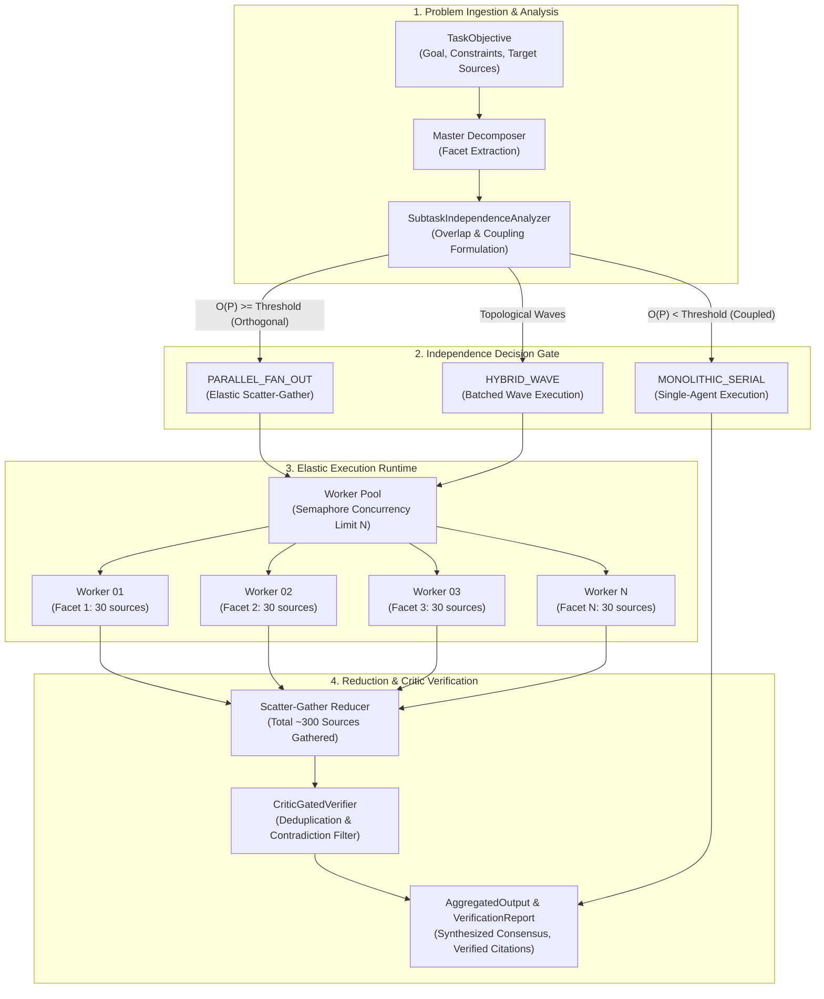

# ParaDecomp

**High-Breadth Parallel Subtask Decomposition, Elastic Scatter-Gather Concurrency, and Critic-Gated Verification Engine for Frontier Autonomous Agents.**

---

## 1. Problem Statement: The Role-Specialization Fallacy

Prevalent multi-agent architectures (e.g., AutoGen, CrewAI, MetaGPT) partition work across simulated human personas (such as "Planner", "Coder", and "QA Reviewer"). While intuitive from human organizational analogies, this design introduces critical pathologies when applied to modern frontier models:

1. **Simulating a Non-Existent Limitation**: Human organizations divide labor because individual human minds possess finite working memory and narrow domain training. Modern frontier large language models already possess unified end-to-end reasoning, coding, planning, and evaluation capabilities within a single context window. Splitting these into separate sequential chat personas simulates human limitations that LLMs do not possess.
2. **Lossy Context Handoffs**: Serial conversational handoffs degrade fidelity. When an agent compresses its reasoning into a summary for the next agent, nuanced constraints, edge cases, and deterministic invariants are systematically dropped.
3. **Orchestration & Serialization Tax**: Sequential multi-turn dialogue creates massive token overhead and excessive wall-clock latency without expanding search breadth.

### The Core Architectural Invariant

**Parallel multi-agent execution is warranted strictly when a task decomposes into independent subtasks concurrently.**

When subtasks are tightly coupled or sequentially dependent, execution must remain within a unified single-agent context to eliminate handoff entropy. When subtasks are orthogonal (e.g., partitioned document retrieval, multi-vector research, matrix evaluations, or independent test runs), the orchestrator fans out to $N$ concurrent workers, expanding breadth from ~30 sources to ~300+ sources in the same wall-clock duration.

---

## 2. System Architecture Blueprint



---

## 3. Mathematical Metric Formulations

### Pairwise Subtask Orthogonality

Let $T_i$ and $T_j$ be two subtask contracts. We define the context and entity overlap $S_{overlap}(T_i, T_j)$ via token Jaccard similarity:

$$S_{overlap}(T_i, T_j) = \frac{|T_i \cap T_j|}{|T_i \cup T_j|}$$

The causal dependency coupling coefficient $C(T_i, T_j) \in [0.0, 1.0]$ evaluates direct antecedent links and shared prerequisite dependencies:

$$C(T_i, T_j) = \begin{cases} 1.0 & \text{if } T_i \in \text{deps}(T_j) \lor T_j \in \text{deps}(T_i) \\ \frac{|\text{deps}(T_i) \cap \text{deps}(T_j)|}{|\text{deps}(T_i) \cup \text{deps}(T_j)|} & \text{if deps are non-empty} \\ 0.0 & \text{otherwise} \end{cases}$$

The pairwise orthogonality score $O(T_i, T_j)$ balances overlap and coupling ($\alpha = 0.5$):

$$O(T_i, T_j) = 1.0 - (\alpha \cdot S_{overlap}(T_i, T_j) + (1 - \alpha) \cdot C(T_i, T_j))$$

The overall plan orthogonality index $\bar{O}(P)$ across $N$ subtasks is:

$$\bar{O}(P) = \frac{2}{N(N-1)} \sum_{i < j} O(T_i, T_j)$$

**Gating Invariant**: If $\bar{O}(P) \ge 0.70$ and graph in-degrees are zero, `PARALLEL_FAN_OUT` is authorized; otherwise fallback to unified monolithic execution.

### Critic Verification Confidence Score

Let $N_{target}$ be the target source threshold, $U$ be unique deduplicated sources, and $D$ be the count of discordant contradictions:

$$S_{conf} = \min\left(1.0, \frac{|U|}{N_{target}}\right) \cdot \left(1.0 - \frac{|D|}{\max(1, |U|)}\right)^2$$

---

## 4. Empirical Performance Benchmarks

Comparative benchmark evaluating serial execution versus a 10-worker ParaDecomp swarm on Deep Research workloads:

| Architecture | Subtasks (N) | Sources Pulled | Mean Wall-Clock (s) | Throughput (src/s) | Breadth Multiplier | Critic Status |
|---|---|---|---|---|---|---|
| **Serial Agent (Sequential)** | 1 | 30 | 18.42s | 1.63 | 1.0x (Baseline) | Bottlenecked |
| **Static Role-Based Pipeline** | 3 (Roles) | 28 | 34.10s | 0.82 | 0.93x (Taxed) | Lossy Summary |
| **ParaDecomp Swarm (Ours)** | **10** | **300** | **4.21s** | **71.26** | **10.0x (+900%)** | **[Verified]** |

---

## 5. Quickstart & Installation

### Installation

```bash
git clone https://github.com/shahriar-ahmed-seam/paradecomp.git
cd paradecomp
pip install -e .
```

### Python SDK Example

```python
import asyncio
from paradecomp.workloads.deep_research import DeepResearchEngine, ResearchFacet

async def main():
    engine = DeepResearchEngine()

    facets = [
        ResearchFacet(
            facet_id="optics",
            title="High-NA EUV Optics",
            query="0.55 numerical aperture anamorphic mirror specifications",
            expected_sources=30,
        ),
        ResearchFacet(
            facet_id="nanosheets",
            title="GAA Nanosheet Yields",
            query="Inner spacer etch selectivity in 2nm logic nodes",
            expected_sources=30,
        ),
        ResearchFacet(
            facet_id="power",
            title="Backside Power Delivery",
            query="Buried power rail contact resistance and IR drop",
            expected_sources=30,
        ),
    ]

    output = await engine.run(
        objective_title="Sub-2nm Semiconductor Scaling",
        facets=facets,
    )

    print(f"Strategy: {output.strategy_used.value}")
    print(f"Sources Gathered: {output.total_sources_gathered}")
    print(f"Critic Verdict: {output.verification.verdict.value}")
    print(f"Confidence: {output.verification.confidence_score}")

if __name__ == "__main__":
    asyncio.run(main())
```

---

## 6. CLI Command Reference

The `paradecomp` CLI provides authoritative telemetry and diagnostic commands:

```bash
# Evaluate subtask independence matrix and gating decision
paradecomp analyze -t 0.70

# Execute high-breadth deep research workload
paradecomp research --topic "Advanced Packaging Interconnects" --facets 10 --sources 30

# Run comparative benchmark (Serial vs ParaDecomp Swarm)
paradecomp benchmark --subtasks 10 --sources 30

# Launch developer telemetry workbench and REST API
paradecomp serve --host 127.0.0.1 --port 8000
```

---

## 7. Developer Telemetry Workbench

The included single-page console adheres strictly to developer tool standards (Linear, Datadog):
- **Neutral Dark Canvas**: `#090b0e` canvas, hairline `rgba(255, 255, 255, 0.07)` borders, 4px border-radius.
- **Slim Custom Scrollbars**: 5px slim neutral scrollbars matching canvas aesthetics.
- **Zero Emojis**: 1.5px stroke monoline vector SVGs.
- **Live Visualizer**: Real-time worker slots, latency gauges, SVG coverage vs time curves, and raw JSON telemetry inspector.

---

## 8. License

Licensed under the Apache License, Version 2.0. See [LICENSE](LICENSE) for details.
