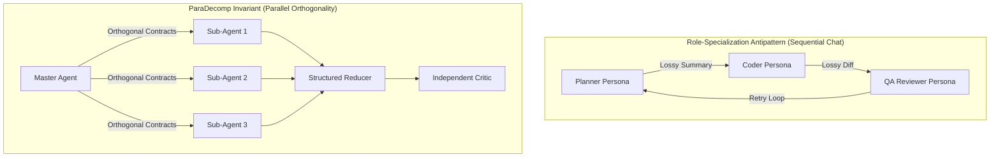
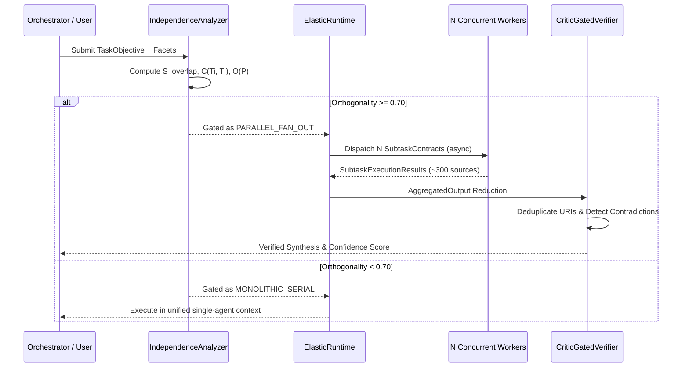

# ParaDecomp System Architecture

This document provides the formal architecture specification for the ParaDecomp runtime, decomposition engine, and critic verification harness.

---

## 1. Architectural Philosophy: Task-Orthogonal Concurrency

ParaDecomp rejects the human roleplay model (Planner -> Coder -> QA) in favor of task-orthogonal concurrency:

---

## 2. Subsystem Dataflow

The execution cycle moves through four deterministic stages:

---

## 3. Failure Mode Analysis and Mitigation Matrix

| Failure Mode | Root Cause Mechanism | Runtime Detection | Mitigation Strategy |
|---|---|---|---|
| **Cyclic Dependency Deadlock** | Misconfigured subtask dependency declarations ($T_a \to T_b \to T_a$) | `topological_sort_waves` in-degree cycle detection | Rejects plan with `ValueError`, triggers immediate fallback to serial monolith. |
| **Worker I/O Timeout** | Downstream HTTP endpoint or web crawler hang | `asyncio.wait_for` timeout threshold | Worker isolates error into `SubtaskExecutionResult(status="FAILED")` without crashing the swarm. |
| **Provider Rate Limiting** | Sudden burst of $N$ sub-agents triggering API 429 | Upstream request spike | Token bucket `RateLimiter` enforces strict requests-per-minute throttle and smooths burst intervals. |
| **Hallucinated Citations** | Sub-agent generating unsupported citations or non-existent URLs | Cross-source citation consistency check in Critic | Critic marks verdict as `REJECTED_HALLUCINATION` or `FLAGGED_DISCREPANCY` and lowers confidence. |
| **Semantic Duplication** | Overlapping research queries retrieving identical documents | Token Jaccard overlap on evidence snippets | `deduplicate_evidence` canonicalizes URIs and collapses snippets with $\ge 0.85$ token overlap. |
